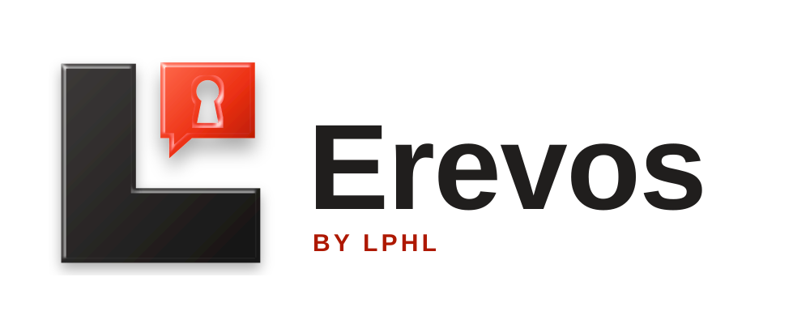
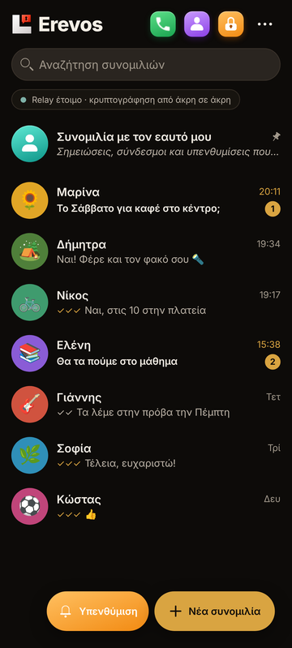
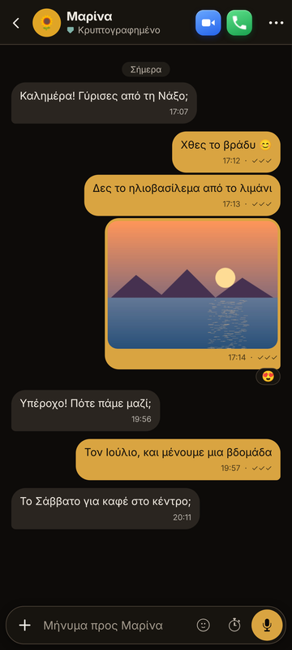
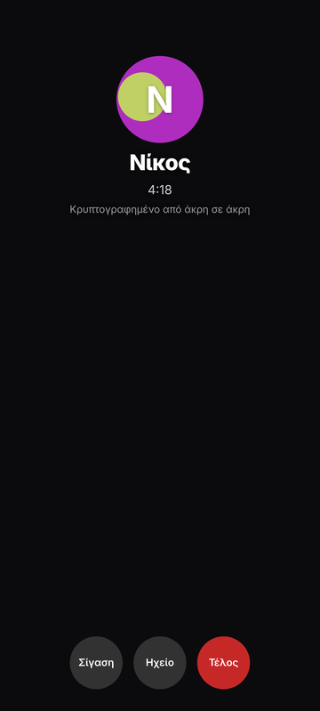
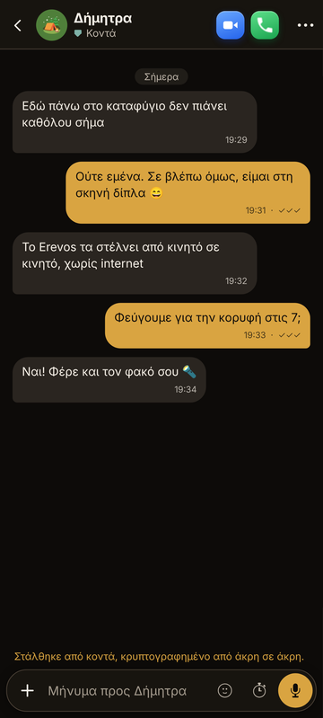
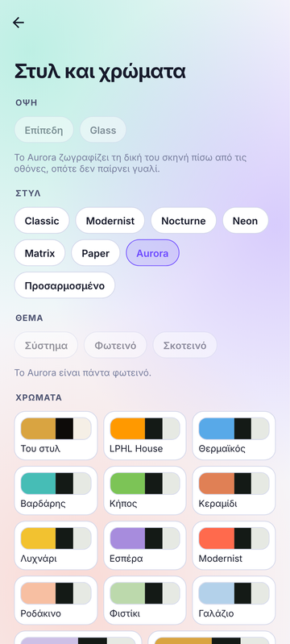

<!--
SPDX-FileCopyrightText: 2026 azzinder
SPDX-License-Identifier: AGPL-3.0-or-later
Additional terms under AGPL-3.0 section 7 apply: see AUTHORS.md.
-->

<p align="center">
  <picture>
    <source media="(prefers-color-scheme: dark)" srcset="brand/erevos-lockup-dark.svg">
    
  </picture>
</p>

<h3 align="center">One private place for your conversations and your files.</h3>

<p align="center">
  Chats and calls with no phone number, no email and no account,<br>
  over the internet or without it, and an encrypted Collection for your photos, videos, music and documents.
</p>

<p align="center">
  <a href="https://github.com/azzinder/erevos-releases/releases"><b>Download</b></a> ·
  <a href="https://lphl.nekten.eu/erevos">Website</a> ·
  <a href="https://erevos-web.lphl.nekten.eu">Web app</a> ·
  <a href="CHANGELOG.md">Changelog</a> ·
  <a href="docs/overview.md">Full overview</a>
</p>

<table align="center">
  <tr>
    <td></td>
    <td></td>
    <td></td>
    <td></td>
    <td></td>
  </tr>
  <tr align="center">
    <td>Chats</td><td>Photos</td><td>Calls</td><td>No internet</td><td>Looks</td>
  </tr>
</table>
<p align="center"><sub>Screens of the Greek app, with made-up names and numbers.</sub></p>

> [!WARNING]
> **Early work, not audited.** No one outside the project has reviewed the code or the cryptography yet. Use it,
> test it and tell us what breaks, but do not rely on it to protect anyone's safety.

## Why Erevos

The well-known apps ask for a phone number, know who talks to whom, and stop when the internet goes down. Erevos asks
for nothing, and finds a way through whatever is there: the internet, Wi-Fi, Bluetooth, a phone nearby.

| | |
|---|---|
| **No identity to give away** | No phone number, no email, no user name. You add people with a QR code or a link, or they invite you. |
| **End-to-end encrypted** | PQXDH and the double ratchet for chats, MLS for groups, new keys every 30 days, safety numbers to compare. |
| **Less for anyone to see** | A separate relay queue for each contact, fixed message sizes, and Tor if you turn it on (it is off by default, as it makes messages slower). |
| **Hidden spaces** | A second password opens a second, separate Erevos that nothing reveals. Hidden chats, a panic button and a panic password are built in. |
| **Works without internet** | Phones nearby talk over Bluetooth LE, Wi-Fi Aware, Wi-Fi Direct, the same Wi-Fi or a hotspot, or a LoRa radio. |
| **Your own relay** | Run your own server (the program comes with Erevos), use your community's, or start with no relay at all. |
| **Calls and groups** | End-to-end encrypted voice and video, group calls (voice up to 8, video up to 4), voice messages, photos, files and polls. |
| **A Collection of your own** | Photos, videos, music and files in an encrypted place, with a player, a slideshow and internet radio. |
| **Phone, SMS and contacts** | On Android Erevos can be your phone, SMS and contacts app too, with the SMS and contacts icons unlocking only themselves. |
| **No ads, no trackers** | Free software, built on others' open-source work that is credited in the app. Nobody pays, nothing is collected. |

## Get it

| Where | How |
|---|---|
| **Android** | The APK from the [releases page](https://github.com/azzinder/erevos-releases/releases). It updates itself once you allow it, and only to builds signed with the same key. |
| **iPhone and any browser** | The [web app](https://erevos-web.lphl.nekten.eu), added to the home screen. Each release is signed, and the app refuses to run anything unsigned. |
| **Linux, Windows and macOS** | The desktop app, from the releases page. |
| **Sailfish OS** | An RPM, from the releases page. |

Every Android release is signed with the same key. The SHA-256 of its certificate (`CN=Erevos, O=LPHL, C=GR`):

```
49:F0:D9:BE:60:09:2F:02:CF:27:C5:24:67:52:55:01:93:A6:7B:81:21:29:BF:53:41:79:53:B7:C8:79:8E:69
```

Compare it with `apksigner verify --print-certs erevos-android.apk`. The web app of a release can be rebuilt from this
source and compared file by file: [docs/reproducible-builds.md](docs/reproducible-builds.md).

## Honest limits

- **Not audited.** The cryptography follows published designs, but no independent expert has checked the code.
- **Not everything has been tried on real phones.** The newest features among them; the changelog and the guide say which.
- **A relay sees some things.** Not what you write, but when messages arrive and, unless you turn Tor on, the address
  your phone connects from.
- **SMS are not private.** When Erevos is your SMS app, your carrier sees SMS as with any app.

Read more: [threat model](docs/threat-model.md) (who Erevos protects you from, and what each one still learns) ·
[security review map](docs/security-review.md) · [reporting a problem](SECURITY.md) · the guide's *Transparency* part
(what the server keeps, for how long, and what has been asked of it).

## Learn more

- [docs/overview.md](docs/overview.md): everything Erevos does, how it works, the platforms, how to build it and how
  releases are made.
- [docs/linked-devices.md](docs/linked-devices.md), [docs/public-groups.md](docs/public-groups.md): design notes.
- [CHANGELOG.md](CHANGELOG.md): what each release changed.
- [CREDITS.md](CREDITS.md): the open-source projects Erevos is built on, with their makers and licences.

## Licence

[AGPL-3.0-or-later](LICENSE), with additional terms under its section 7: keep "Erevos, by azzinder", mark a changed
version as changed, and give it another name. Who makes Erevos, and the terms in full: [AUTHORS.md](AUTHORS.md).
Every file says whose it is and under which licence, the [REUSE](https://reuse.software) way.
