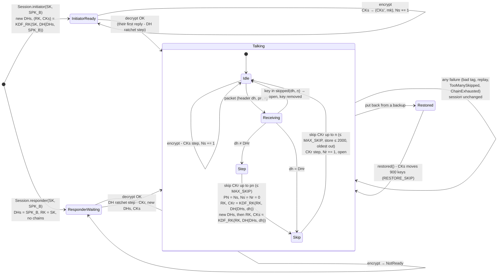
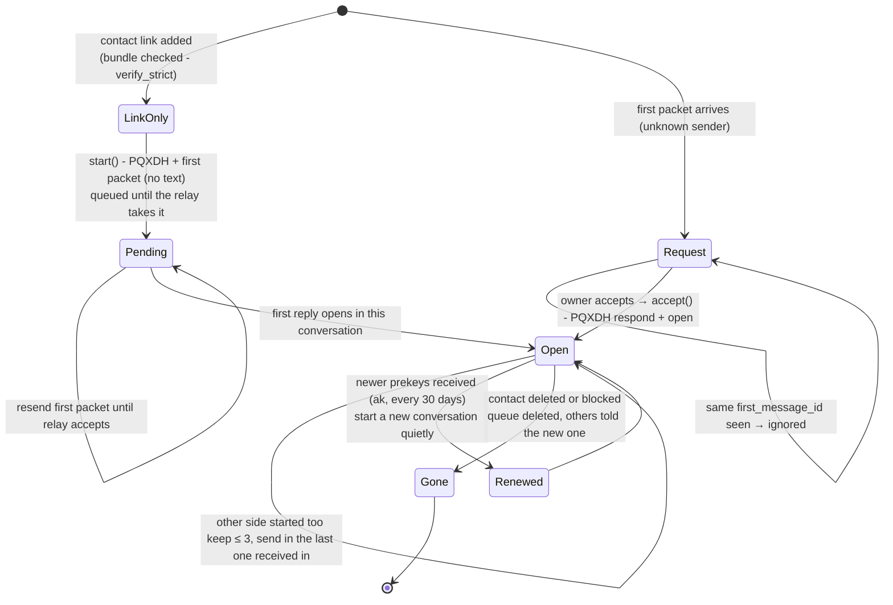
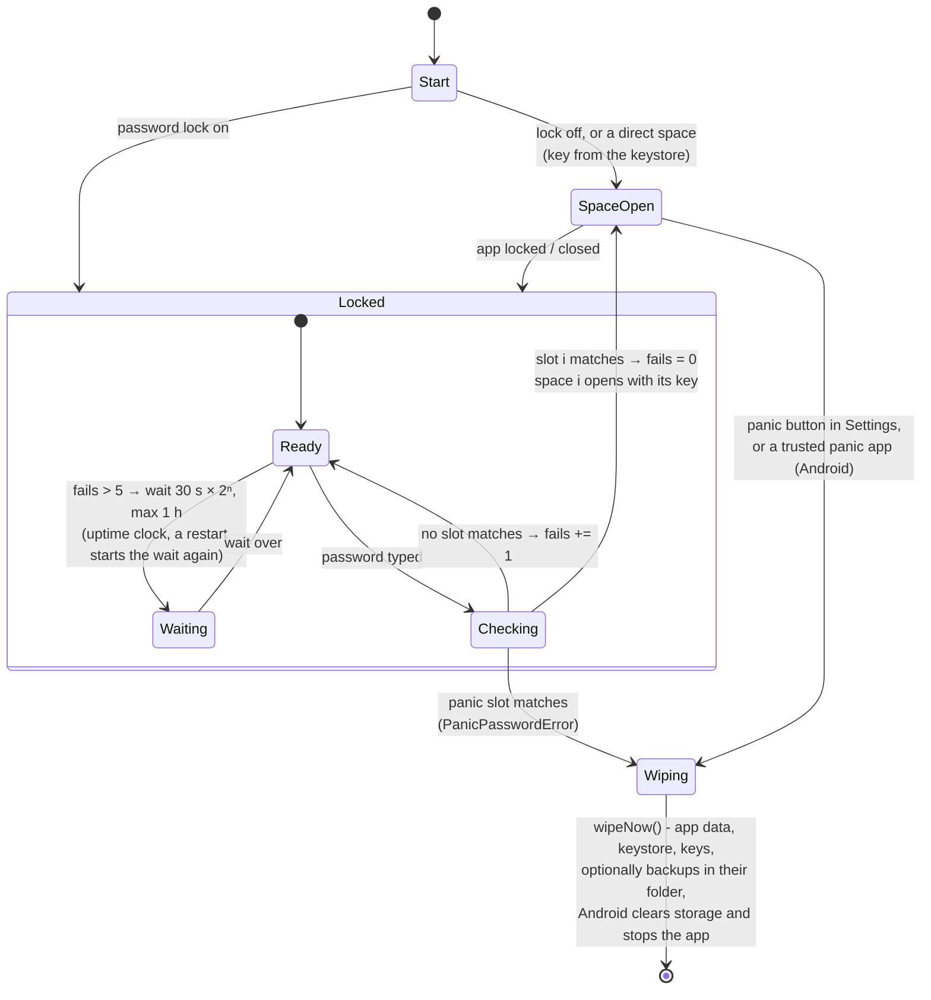
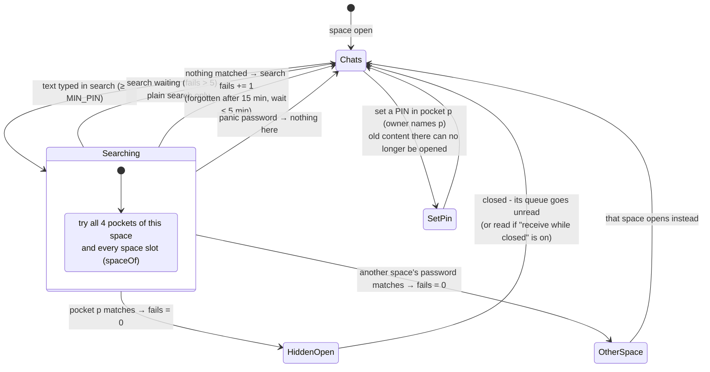
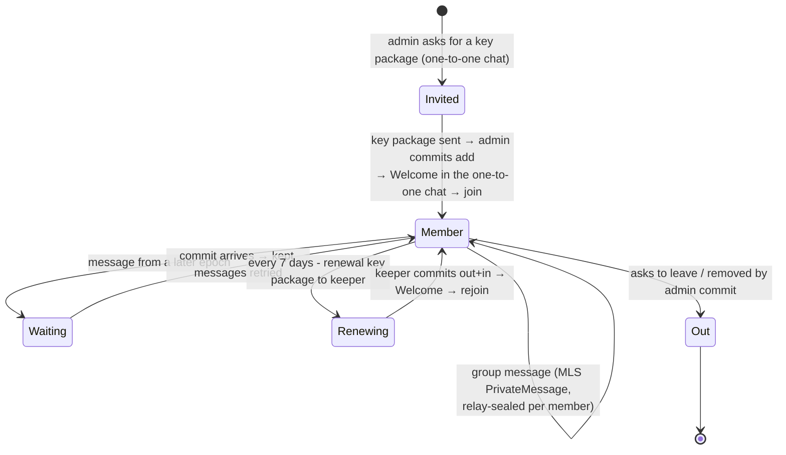

<!--
SPDX-FileCopyrightText: 2026 azzinder
SPDX-License-Identifier: AGPL-3.0-or-later
-->

# State machines

The states of the parts reviewers most often ask about, drawn from the code. **Not audited.** The
formats and key derivations behind each step are in [protocol.md](protocol.md). The diagrams are
Mermaid, which GitHub renders.

## 1. Double ratchet session

`crates/erevos-core/src/ratchet.rs`. Every receive works on a copy of the session and keeps it only
when the AEAD tag checks. So each arrow out of a receive state is taken only on success, and every
failure returns to the state it started from, unchanged.

## 2. Conversation with a contact

`crates/erevos-core/src/conversation.rs`, `app/lib/e2e.ts`. This is the app's view of one contact.
It can hold up to 3 conversations (`MAX_CONVERSATIONS`).

## 3. Lock screen, spaces and the panic password

`app/lock/config.ts` (`unlock`, `countedMatch`), `app/lock/tries.ts`, `app/lock/gate.tsx`,
`app/lib/panic.ts`. All slots, plus the panic slot, are checked on every try. So the time a try
takes does not depend on which slot matches, or on whether any matches.

## 4. Hidden chats and the search

`app/lock/hidden.ts` (`searchHidden`, `searchOpens`), `app/lock/tries.ts`, with the counter
`SEARCH_TRIES` kept apart from the lock screen's. Every space has 4 pockets from its first start,
set or not. Every search with at least the minimum PIN length tries every pocket of the open space
and every space's password, whatever was typed.

## 5. Group membership (MLS)

`crates/erevos-group`, `app/lib/groups.ts`. Only the admin or keeper commits.

